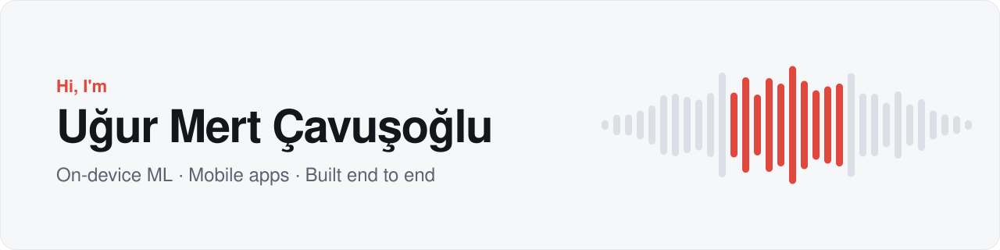
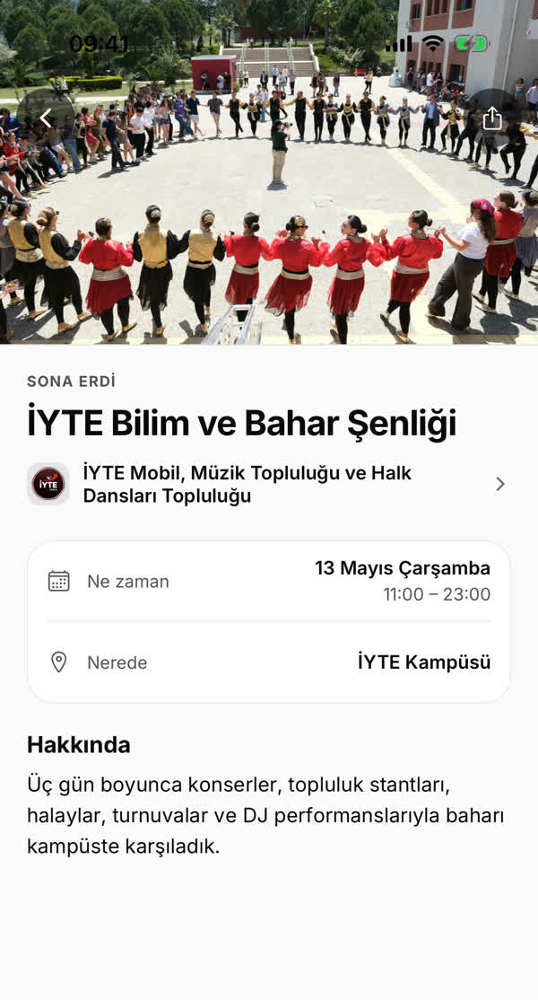

<picture>
  <source media="(prefers-color-scheme: dark)" srcset="assets/banner-dark.svg">
  
</picture>

  
  
  

Computer Engineering student. I build machine learning that runs on the phone and the products around it: model, backend, mobile client and deployment.

| Now | |
|:--|:--|
| **Building** | İYTE Mobile, a campus app live on the App Store and Google Play |
| **Interning** | ML Engineer at HubX: a real-time on-device avatar with expression and lip-sync models |
| **Exploring** | Model compression for mobile and generative video |

## İYTE Mobile

<table>
<tr>
<td width="62%" valign="top">

A campus app for İzmir Institute of Technology students. I built all of it solo and run it in production.

**Mobile:** React Native and Expo. Social feed, real-time chat, clubs and events, carpooling, bus schedules, cafeteria menus, push notifications.

**Backend:** NestJS, PostgreSQL with Prisma, MongoDB for chat, Redis, Socket.IO.

**Infrastructure:** Docker on Ubuntu, Nginx with rate limiting, Suricata IDS and Wazuh SIEM.

**Also:** React admin panel, Python scrapers and a [Next.js website](https://github.com/ugurcavusoglu/iytemobil_website).

</td>
<td width="38%" align="center" valign="top">

</td>
</tr>
</table>

## Other projects

| | |
|:--|:--|
| [**Phixora**](https://github.com/ugurcavusoglu/phixora) | AI image editing: super-resolution, denoising, background removal. React, NestJS, PostgreSQL. |
| [**Alignment via DPO**](https://github.com/ugurcavusoglu/Alignment-via-DPO) | TinyLlama-1.1B aligned with SFT and DPO using LoRA on HH-RLHF. |
| [**NLP Model Benchmark**](https://github.com/ugurcavusoglu/NLP_Midterm) | Classical, recurrent and transformer models compared on five NLP tasks. |
| [**SmartJuice**](https://github.com/ugurcavusoglu/smartjuice-app) | Flutter app for a smart juice device, with a custom physics animation and BLE device states. |

Private work I'm happy to talk about: a multi-agent software delivery system on Claude Code, retinal vessel extraction, fire detection, people counting and object tracking with OpenCV.

## Tools

  

